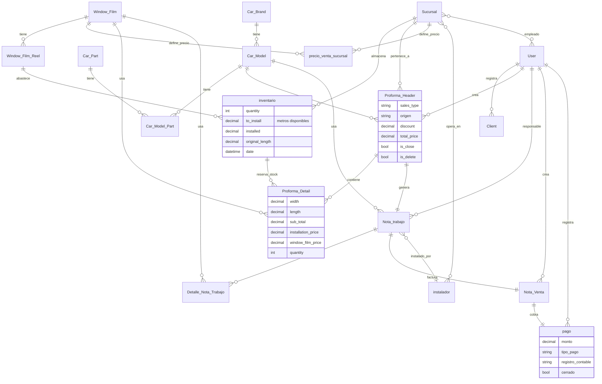

# Auditoría de backend — praxsa-django-panel-admin

Auditoría en modo solo lectura del backend Django ubicado en `praxsa_manager/`. No se modificó, movió ni borró ningún archivo existente del repositorio; este documento es el único artefacto generado.

Todas las rutas de archivo son relativas a `praxsa_manager/` salvo que se indique lo contrario.

---

# PARTE 1 — Arquitectura

## 1. Estructura del proyecto

Layout de nivel superior del monorepo:

```
praxsa-django-panel-admin/
├── Dockerfile                     # Dockerfile raíz/legacy (python:3.8-alpine)
├── docker-compose.dev.yml / .prod.yml / .stg.yml
├── nginx/                         # configs + Dockerfiles de nginx por entorno
├── docs/CLAUDE.md                 # notas del proyecto para desarrollo asistido por IA
├── praxsa_manager/                # backend Django (foco de esta auditoría)
└── proforma/                      # frontend Angular (fuera de alcance)
```

Es un **monorepo con un único proyecto Django y una única app**:

- Proyecto: `praxsa_manager/praxsa_manager/` (settings.py, urls.py, wsgi.py, asgi.py).
- App: `praxsa_manager/product/` ([apps.py:4-6](praxsa_manager/product/apps.py) — `ProductConfig`, label `product`).

Toda la lógica (admin, API, formularios, reglas de negocio) vive dentro de `product/`, organizada en subpaquetes:

- `admin_config/` — clases `ModelAdmin` (aquí vive la mayor parte de la lógica de negocio del panel).
- `business/` — clases de servicio reutilizadas por admin y por la API (`proforma.py`, `inventario.py`, `pago.py`, `orden_trabajo.py`).
- `Forms/` — `ModelForm`s usados por el admin.
- `custom_views/` — `APIView`s de DRF.
- `serializer/` — serializers de DRF.
- `helper/` — constantes y lookups pequeños.
- `utils/exception/` — excepciones custom.
- `migrations/` — 105 migraciones.

### Versiones

- **Django**: `4.2.1`
- **Django REST Framework**: `3.14.0`
- **Python**: sin fuente única de verdad — inconsistente entre archivos:
  - `Dockerfile:1` (raíz/legacy) → `python:3.8-alpine`
  - `praxsa_manager/Dockerfile.stg:1` → `python:3.8-alpine`
  - `praxsa_manager/Dockerfile.prod:1` → `python:3.10-alpine`
  - Nombre del archivo de dependencias: `requirements-3.8.10.txt` (sugiere 3.8.10)
  - `.venv` committeado en el repo: Python **3.10.0** (`praxsa_manager/.venv/pyvenv.cfg`)
  - No existe `runtime.txt`, `tox.ini`, `setup.cfg`, `pyproject.toml` ni configuración de CI.

### Dependencias principales

Archivo: `praxsa_manager/requirements-3.8.10.txt` (no hay `requirements.txt`, `Pipfile` ni `pyproject.toml`).

| Paquete | Versión |
|---|---|
| Django | 4.2.1 |
| djangorestframework | 3.14.0 |
| django-cors-headers | 4.0.0 |
| django-environ | 0.10.0 |
| django-filter | 23.2 |
| django-admin-list-filter-dropdown | 1.0.3 |
| django-admin-logs | 1.2.0 |
| django-admin-rangefilter | 0.12.4 |
| django-bootstrap-v5 | 1.0.11 |
| django-tinymce | 3.6.1 |
| psycopg2 | 2.9.6 (driver Postgres) |
| gunicorn | 20.1.0 (servidor WSGI de prod) |
| Pillow, reportlab, martor, Markdown, bleach, beautifulsoup4, requests | varios |

### Configuración por entorno

No hay paquete `settings/` dividido por entorno — un único archivo `praxsa_manager/praxsa_manager/settings.py` (300 líneas). La separación de entornos se hace mediante **4 archivos `.env*`** que se copian al nombre literal `.env` en tiempo de build de Docker:

- `.env` (dev local, `ENV=DEV`)
- `.env-dev`
- `.env-prod`
- `.env-stg`

Mecanismo de selección: `settings.py:26` — `environ.Env.read_env(os.path.join(BASE_DIR, '.env'))` — siempre lee un archivo llamado literalmente `.env`. Cada Dockerfile copia el archivo correcto sobre `.env` en build:

- `Dockerfile.prod:11` → `COPY .env-prod ./.env`
- `Dockerfile.stg:11` → `COPY .env ./.env` (copia el `.env` plano, **no** `.env-stg` — revisar si es intencional)
- `Dockerfile` raíz:16 → `# COPY .env-prod ./.env` (comentado — esta imagen no trae `.env` salvo que se monte externamente)

No se usa `DJANGO_SETTINGS_MODULE` en ninguna parte del repo.

---

## 2. Modelos

Los 20 modelos del proyecto viven en un único archivo: [product/models.py](praxsa_manager/product/models.py) (312 líneas). No hay paquete `models/`.

### Inventario de modelos (resumen de campos clave)

| Modelo | Línea | Campos clave | Relaciones |
|---|---|---|---|
| `Car_Brand` | 16 | `name` (unique) | — |
| `Car_Model` | 24 | `name` (unique) | FK → `Car_Brand` |
| `Car_Part` | 33 | `name` | — |
| `Car_Model_Part` | 41 | `width`, `length`, `quantity`, `installation_price` (Decimal) | FK → `Car_Model`, `Car_Part`; unique(`car_model_id`,`car_part_id`) |
| `Window_Film` | 57 | `name`, `description`, `content` (HTML) | — |
| `Window_Film_Reel` (verbose "Bobina" — catálogo/spec) | 67 | `width`, `length`, `price` (Decimal) | FK → `Window_Film` |
| `Client` | 89 | `name`, `last_name`, `phone_number`*, `ci_nit`* | FK → `User` (nullable) |
| `Sucursal` | 101 | `name`, `address`, `enable_to_install_windows_film` (bool) | M2M → `User` (empleado) |
| `instalador` | 111 | `name`, `address`, `phonenumber`* | M2M → `Sucursal` |
| `inventario` (stock real por sucursal/bobina — el "metros disponibles") | 119 | `quantity`, `to_install` (Decimal, metros disponibles), `installed` (Decimal), `original_length`, `date`, `precio_compra_mtr_lineal`, `precio_venta_mtr_lineal` | FK → `Sucursal`, `Window_Film_Reel` |
| `inventario_proxy`, `utilidades` | 134, 139 | proxies de `inventario` para reportes | — |
| `Proforma_Header` (la "Proforma") | 144 | `sales_type`, `origen`, `discount`, `total_price` (Decimal), `is_close`, `is_delete` | FK → `Sucursal`, `Car_Model`, `User` (created_by) |
| `Proxy_Proforma` | 173 | proxy de `Proforma_Header` | — |
| `Nota_trabajo` (orden de trabajo/instalación) | 179 | `codigo_garantia` (unique), `entrada_vehiculo`, `salida_vehiculo`, `is_close` | O2O → `Proforma_Header`; FK → `instalador`, `User` (responsable), `Car_Model` |
| `Detalle_Nota_Trabajo` | 199 | `width`, `length` | FK → `Nota_trabajo`, `Window_Film` (ambas con `related_name='detalle_trabajo'`) |
| `Proforma_Detail` (líneas de la proforma) | 224 | `width`, `length`, `sub_total`, `installation_price`, `window_film_price` (todos Decimal), `quantity` | FK → `inventario` (nullable), `Proforma_Header` (related_name `items`), `Window_Film`, `Car_Part` |
| `Nota_Venta` | 245 | `total_price` (Decimal), `is_close` | O2O → `Nota_trabajo`; FK → `User` (created_by) |
| `pago` | 265 | `monto` (Decimal), `tipo_pago`, `registro_contable` (unique parcial), `cerrado` | O2O → `Nota_Venta` (blank=True, sin null=True); FK → `User` |
| `Proxy_Pagos` | 298 | proxy de `pago` | — |
| `precio_venta_sucursal` | 304 | `width`, `precio_venta` (Decimal) | FK → `Window_Film`, `Sucursal` |

`*` = `CharField` declarado sin `max_length` (ver hallazgo QUAL-02).

**Todas las FK usan `on_delete=models.DO_NOTHING`** — no hay estrategia de cascada/protección a nivel ORM en ningún modelo (ver BIZ-06).

**Todos los campos de dinero son `DecimalField(max_digits=10, decimal_places=2)`** — no hay ningún `FloatField` para dinero en el esquema actual (solo aparece en migraciones antiguas ya reemplazadas: `migrations/0002_car_brand_car_model_car_model_part_and_more.py:34-35,60-61`). Este es un hallazgo **positivo**.

### Estado de la proforma: no es un campo, es inferido

No existe un campo `status`/`estado` persistido en `Proforma_Header`, pese a que `helper/proforma.py:1-19` define una lista de estados posibles. El estado efectivo se deriva en tiempo de lectura recorriendo relaciones inversas ([admin_config/proforma_admin.py:96-111](praxsa_manager/product/admin_config/proforma_admin.py)):

```python
if hasattr(obj, 'nota_trabajo'): estado = 'Nota Trabajo'
if hasattr(obj.nota_trabajo, 'nota_venta'): estado = 'Por Cobrar'
if hasattr(obj.nota_trabajo.nota_venta, 'pago'): estado = 'Finalizado'
```

Es decir, el flujo real "pendiente → instalado → por cobrar → pagado" es: `Proforma_Header` → (O2O) `Nota_trabajo` → (O2O) `Nota_Venta` → (O2O) `pago`. Ver BIZ-04.

### Diagrama entidad-relación (Mermaid)



---

## 3. Endpoints

### 3.1 `praxsa_manager/urls.py`

- `path('product/', include("product.urls"))` — [urls.py:39](praxsa_manager/praxsa_manager/urls.py)
- `path('admin/', admin.site.urls)` — línea 40 (ruta por defecto, no ofuscada)
- `path('api-auth/', include('rest_framework.urls'))` — línea 42
- Un router `UserViewSet` (líneas 23-35) está definido pero **comentado** (`#path('', include(router.urls))`, línea 38) — código muerto, expondría `User.email`/`is_staff` si se reactivara.

### 3.2 `product/urls.py` (todo bajo `/product/`)

| Método | Ruta | Vista (archivo:línea) | Serializer | Auth/Permisos | Chequeo de ownership |
|---|---|---|---|---|---|
| GET | `get_car_part_info/<car_model_id>/<sucursal_id>` | `views.get_car_part_info` — [views.py:54](praxsa_manager/product/views.py) | ninguno | **Ninguno** — vista de función plana, no `@api_view`, DRF no aplica | filtra por path params, sin auth |
| GET | `get_proforma_car_part_info/<proforma_id>` | `views.get_proforma_car_part_info` — [views.py:143](praxsa_manager/product/views.py) | ninguno | ninguno | **IDOR**: `.get(pk=proforma_id)` sin filtrar por usuario |
| GET | `calculator_info` | `views.get_calculator_info` — [views.py:226](praxsa_manager/product/views.py) | ninguno | ninguno | datos de referencia públicos (marcas/modelos/sucursales), ok |
| GET | `model_parts/<model_id>` | `views.get_model_parts` — [views.py:287](praxsa_manager/product/views.py) | ninguno | ninguno | filtra por `model_id` únicamente |
| GET | `get_inventory/<sucursal_id>/<lamina_id>/<width>` | `views.get_inventory` — [views.py:195](praxsa_manager/product/views.py) | ninguno | ninguno | expone stock y precios de cualquier sucursal sin auth |
| POST | `create_client` | `views.create_client` — [views.py:305-313](praxsa_manager/product/views.py) | `ClientSerializer` | `@permission_classes((AllowAny,))` (intencional, autoregistro), `@transaction.atomic` | n/a |
| POST | `api-token-auth/` | `CustomAuthToken` — [custom_views/auth_token.py:6](praxsa_manager/product/custom_views/auth_token.py) | `AuthTokenSerializer` (DRF) | `ObtainAuthToken` default (`AllowAny`) | n/a |
| POST | `invoice` | `InvoiceView.post` — [custom_views/invoice.py:20](praxsa_manager/product/custom_views/invoice.py) | `SalesHeaderSerializer` | `TokenAuthentication` + `IsAuthenticated` | crea con `created_by=request.user` |
| GET | `invoice/<pk>/` | `InvoiceView.get` — [custom_views/invoice.py:36](praxsa_manager/product/custom_views/invoice.py) | manual | `TokenAuthentication` + `IsAuthenticated` | **IDOR**: `Proforma_Header.objects....get(id=pk)` sin filtrar por `created_by` |
| GET | `invoice/all` | `ListUserInvoice.get` — [custom_views/invoice.py:86](praxsa_manager/product/custom_views/invoice.py) | manual | `TokenAuthentication` + `IsAuthenticated` | **Correcto**: `filter(created_by=request.user.id)` |
| GET | `bobina/<pk>` | `views.get_bobina` — [views.py:37](praxsa_manager/product/views.py) | ninguno | ninguno (vista plana) | sin auth |
| GET | `layer/<layer_id>` | `views.get_layer_info` — [views.py:187](praxsa_manager/product/views.py) | ninguno | ninguno | filtra por pk únicamente |

Nota: existe una clase `BobinaView` con auth ([custom_views/bobina.py:8](praxsa_manager/product/custom_views/bobina.py)) que coincidiría con el mismo patrón de ruta `bobina/<pk>`, pero **nunca está enrutada** en `urls.py` — la ruta viva es la función sin autenticación `views.get_bobina`.

**Configuración DRF global** ([settings.py:119-125](praxsa_manager/praxsa_manager/settings.py)):

```python
REST_FRAMEWORK = {
    'DEFAULT_PERMISSION_CLASSES': [
        'rest_framework.permissions.DjangoModelPermissionsOrAnonReadOnly'
    ]
}
```

No hay `DEFAULT_AUTHENTICATION_CLASSES` ni configuración de paginación. Esta clase de permiso por defecto solo protege vistas DRF reales (`APIView`/viewsets) — la mayoría de `product/views.py` son vistas de función Django planas que la esquivan por completo.

---

## 4. Flujo de creación de una proforma

Existen **dos caminos independientes** para crear una proforma.

### Camino A — Panel de administración de Django (flujo "real" de negocio)

1. **Vista**: `add_view` estándar del admin para `Proforma_Header`, registrado en [product/admin.py:45](praxsa_manager/product/admin.py) → `ProformaAdmin`.
2. **Formulario de cabecera**: `SaleHeaderForm` — [Forms/Sale_header.py:9-53](praxsa_manager/product/Forms/Sale_header.py), `Meta.fields = "__all__"` (línea 52-53) — `total_price` es un campo de formulario común, editable por el cliente del navegador, no calculado.
3. **Formset inline de líneas**: `SalesDetailInLine` — [admin_config/proforma_admin.py:23-57](praxsa_manager/product/admin_config/proforma_admin.py), usa `CarModelPartForm` — [Forms/car_model_part.py:13-98](praxsa_manager/product/Forms/car_model_part.py), `Meta.fields = "__all__"` (línea 97): `sub_total`, `window_film_price`, `installation_price` son todos campos editables. Única validación: `clean_sub_total` rechaza `sub_total <= 0` (líneas 29-34) y `clean_length` rechaza `length <= 0` (líneas 36-42) — nada recalcula estos valores desde `Window_Film_Reel.price` ni `Car_Model_Part.installation_price`.
4. **Cálculo del lado del cliente**: `product/static/product/sales_event.js:270-292` (`calculate_subtotal`) calcula `subtotal = (length * quantity * film_price) + (installation_price * quantity)` **en el navegador** y lo escribe en los inputs `sub_total`/`total_price` (marcados `readonly` en el HTML, pero eso es solo un atributo de UI — igual se envían en el POST).
5. **Guardado**: `ProformaAdmin.save_model` — [admin_config/proforma_admin.py:207-209](praxsa_manager/product/admin_config/proforma_admin.py):
   ```python
   def save_model(self, request, obj, form, change):
       obj.created_by = request.user
       super().save_model(request, obj, form, change)
   ```
   `obj.total_price` en este punto es exactamente lo que llegó en el POST (paso 4), sin modificar.
6. `ProformaAdmin.save_related` — [admin_config/proforma_admin.py:149-163](praxsa_manager/product/admin_config/proforma_admin.py). En **creación** (`change == False`) este método no hace nada más que `super().save_related()` — guarda las líneas `Proforma_Detail` tal cual fueron enviadas (incluyendo su `sub_total` calculado en el cliente) y **nunca verifica que `Proforma_Header.total_price == Σ Proforma_Detail.sub_total`**.
7. No hay `save()` override en el modelo ni señales (`post_save`/`pre_save`/`@receiver`) conectadas a `Proforma_Header` o modelos relacionados (verificado por búsqueda en todo `product/`).
8. **No se toca el inventario en este paso** — ver sección 6.

### Camino B — Endpoint REST de la "calculadora" (`POST /product/invoice`)

1. `InvoiceView.post` — [custom_views/invoice.py:20-34](praxsa_manager/product/custom_views/invoice.py):
   ```python
   @transaction.atomic
   def post(self, request, *args, **kwargs):
       with transaction.atomic():
           user = request.user
           request.data['created_by'] = user.id
           serializer = SalesHeaderSerializer(data=request.data)
           if serializer.is_valid():
               invoice = serializer.save()
               return Response(data={"id": invoice.id}, status=status.HTTP_201_CREATED)
   ```
2. **Serializer**: `SalesHeaderSerializer` — [serializer/invoice_serializer.py:25-48](praxsa_manager/product/serializer/invoice_serializer.py). `Meta.fields` incluye `total_price` como campo escribible (línea 31, sin `read_only_fields`). El serializer anidado `SaleDetailSerializer` (líneas 11-23) incluye `sub_total`, `window_film_price`, `installation_price` como campos escribibles.
3. `create()` — [invoice_serializer.py:33-44](praxsa_manager/product/serializer/invoice_serializer.py):
   ```python
   def create(self, validate_data):
       items = validate_data.pop('carPartItems')
       invoice = Proforma_Header.objects.create(proforma_created_on=timezone.now(), origen=self.helper.origen_calculadora, **validate_data)
       for item in items:
           detail = Proforma_Detail(proforma_header=invoice, **item)
           detail.save()
       return invoice
   ```
   No hay ningún lookup de `Window_Film_Reel.price` ni `Car_Model_Part.installation_price` en toda la cadena — los números quedan en la BD exactamente como se enviaron.
4. Este camino tampoco toca inventario en la creación.

---

## 5. Cálculo de precio

**El backend NO calcula el precio/total en ninguno de los dos caminos de creación. Confía en los valores enviados directamente por el cliente.**

Evidencia:

- Camino admin: `Proforma_Header.total_price` y `Proforma_Detail.sub_total`/`window_film_price`/`installation_price` son campos de `ModelForm` con `fields = "__all__"` ([Forms/Sale_header.py:52-53](praxsa_manager/product/Forms/Sale_header.py), [Forms/car_model_part.py:97](praxsa_manager/product/Forms/car_model_part.py)). El único recálculo server-side existe solo al **editar** una proforma (`save_related`, [admin_config/proforma_admin.py:150-162](praxsa_manager/product/admin_config/proforma_admin.py): `total_price = total_price - Σ(sub_totals eliminados)`), y ese recálculo parte del propio `total_price`/`sub_total` ya confiado del cliente, no de `Window_Film_Reel.price`. En la creación inicial no hay recálculo alguno.
- Camino REST: `SaleDetailSerializer` y `SalesHeaderSerializer` listan `sub_total`, `window_film_price`, `installation_price`, `total_price` como campos escribibles sin `read_only_fields` ([serializer/invoice_serializer.py:14-23,31](praxsa_manager/product/serializer/invoice_serializer.py)); `create()` persiste los valores recibidos tal cual.
- Los únicos lugares donde el precio real de las tablas de precios (`Window_Film_Reel.price`, `precio_venta_sucursal.precio_venta`) se calcula son endpoints GET **informativos** (`get_car_part_info` — [views.py:54-141](praxsa_manager/product/views.py), `get_inventory` — [views.py:195-223](praxsa_manager/product/views.py)) que sugieren un precio al frontend/calculadora — pero nada obliga a que el `sub_total`/`total_price` enviado luego en la creación coincida con esos números.

**Ambigüedad a señalar explícitamente**: no se encontró ningún test, validador o método `clean()` en todo el repositorio que verifique `sub_total == length * quantity * window_film_price + installation_price * quantity` o `total_price == Σ sub_total - discount` del lado del servidor. Dado el alcance exhaustivo de la búsqueda (grep completo sobre `product/` + lectura manual de `serializer/`, `Forms/`, `business/`, `admin_config/` relacionados a Proforma), esto se reporta como ausencia confirmada, no como dato no verificado.

---

## 6. Inventario: cómo se afectan las bobinas (metros disponibles)

**No hay ninguna mutación de inventario al crear una proforma, ni al pagarla.** El campo `inventario.to_install` (metros disponibles) solo se modifica en tres puntos, todos posteriores, ligados a la orden de trabajo/instalación:

### 6.1 Descuento al crear la "Nota de Trabajo" (paso equivalente a "instalación confirmada")

`Proforma_Business.create_work_note` → [business/proforma.py:72-112](praxsa_manager/product/business/proforma.py), llama a `Inventario_Business.reduce_inventory` — [business/inventario.py:35-53](praxsa_manager/product/business/inventario.py):

```python
def reduce_inventory(self, sucursal, windows_film, width, length_to_reduce):
    query = inventario.objects.select_related(...).filter(sucursal=sucursal, bobina__window_film=windows_film,
                                                           bobina__width=width, to_install__gte=length_to_reduce)
    query = query.order_by('bobina__width', 'date')[:1]
    if query.exists():
        bobina_inventario = query[0]
        bobina_inventario.to_install = bobina_inventario.to_install - length_to_reduce
        bobina_inventario.installed = bobina_inventario.installed + length_to_reduce
        bobina_inventario.save()
        return bobina_inventario
    raise NoHayLaminasDisponibles(...)
```

Invocado desde `create_work_note`, envuelto en `@transaction.atomic` / `with transaction.atomic()`.

### 6.2 Devolución al reabrir una proforma

`Proforma_Business.abrir_proforma` — [business/proforma.py:38-58](praxsa_manager/product/business/proforma.py), llama a `Inventario_Business.return_to_inventory` — [business/inventario.py:56-66](praxsa_manager/product/business/inventario.py) (`to_install += length_to_add`, `installed -= length_to_add`, `.save()`).

### 6.3 Devolución al borrar la nota de trabajo

`Orden_Trabajo_Business.delete_work_note` — [business/orden_trabajo.py:58-85](praxsa_manager/product/business/orden_trabajo.py), líneas 70-77, **duplica** la lógica de devolución en línea en vez de reutilizar `return_to_inventory`.

### 6.4 El pago NO toca inventario

`Pago_Business.cerrar_pago` — [business/pago.py:5-22](praxsa_manager/product/business/pago.py) solo cambia banderas `cerrado`/`is_close` en `pago`, `Nota_Venta`, `Proforma_Header`, `Nota_trabajo` — ninguna escritura a `inventario`.

### 6.5 Ausencia de bloqueo de fila (ver BIZ-02)

Ninguno de los tres puntos de mutación usa `select_for_update()` (cero coincidencias en todo el repo). Todos están protegidos solo por `transaction.atomic()`, que en aislamiento `READ COMMITTED` no bloquea la fila en un `SELECT`/`.exists()`/`[0]` — solo garantiza que las escrituras dentro del bloque sean atómicas entre sí. Esto habilita una condición de carrera clásica de lectura-luego-escritura: dos llamadas concurrentes a `create_work_note` para la misma sucursal/lámina/ancho pueden leer el mismo `to_install` antes de que cualquiera confirme su `UPDATE`, ambas ver stock suficiente, y ambas descontar — resultando en sobreventa o `to_install` negativo.

**Código muerto relacionado**: `Inventory_helper.update_inventory`/`get_bobina_by_sucursal_lamina_width` ([helper/inventory.py:6-25](praxsa_manager/product/helper/inventory.py)) y `CarModelPartForm.update_inventory`/`is_inventory_valid` ([Forms/car_model_part.py:20-27,92-93](praxsa_manager/product/Forms/car_model_part.py)) no tienen ningún llamador en todo el codebase (verificado por grep).

---

## 7. Panel de administrador de Django

Ruta: `/admin/` (por defecto, no ofuscada — [urls.py:40](praxsa_manager/praxsa_manager/urls.py)). Branding: `admin.site.site_header = 'Praxsa Panel Admin'` ([product/admin.py:5](praxsa_manager/product/admin.py)).

### Modelos registrados ([product/admin.py:33-56](praxsa_manager/product/admin.py))

| Modelo | ModelAdmin |
|---|---|
| `instalador` | `Installer` |
| `Car_Brand` | `CarBrand` |
| `Car_Model` | `CarModel` |
| `Car_Model_Part` | `CarModelPart` |
| `Car_Part` | *(admin por defecto)* |
| `Sucursal` | *(admin por defecto)* |
| `inventario` | `InventoryAdmin` |
| `Window_Film` | `WindowFilm` |
| `Window_Film_Reel` | `WindowFilmReel` |
| `Client` | *(admin por defecto)* |
| `Proforma_Header` | `ProformaAdmin` |
| `Nota_trabajo` | `NotaTrabajoAdmin` |
| `Proxy_Nota_trabajo` | `ReportNotaTrabajoAdmin` |
| `Proxy_Proforma` | `ReportProformaAdmin` |
| `pago` | `PagosAdmin` |
| `Proxy_Pagos` | `ReportDailySellAdmin` |
| `inventario_proxy` | `ReportStorageAdmin` |
| `utilidades` | `ReportUtilidadAdmin` |
| `precio_venta_sucursal` | `PrecioVentaSucursalAdmin` |
| `Nota_Venta` | `NotaVentaAdmin` |

No registrados (comentados): `instalador_sucursal`, `Window_Film_Reel_Storage`.

### Quién puede entrar y con qué permisos

El acceso al admin sigue el sistema estándar de permisos de Django (staff + permisos de modelo), pero el **filtrado por sucursal/rol dentro de cada `ModelAdmin.get_queryset()` es inconsistente**:

- **Sí filtran correctamente por sucursal del usuario**: `InventoryAdmin` ([admin_config/inventory.py:43-55](praxsa_manager/product/admin_config/inventory.py)), `NotaTrabajoAdmin` ([admin_config/nota_trabajo.py:130-136](praxsa_manager/product/admin_config/nota_trabajo.py)), `NotaVentaAdmin` ([admin_config/nota_venta.py:114-120](praxsa_manager/product/admin_config/nota_venta.py)), `ProformaAdmin` ([admin_config/proforma_admin.py:191-197](praxsa_manager/product/admin_config/proforma_admin.py)), `PrecioVentaSucursalAdmin` ([admin_config/precio_venta_sucursal.py:54-60](praxsa_manager/product/admin_config/precio_venta_sucursal.py)).
- **No filtran** (exponen datos de todas las sucursales a cualquier staff con permiso sobre el modelo): `PagosAdmin` ([admin_config/pagos.py:131-138](praxsa_manager/product/admin_config/pagos.py)), `ReportDailySellAdmin` ([admin_config/report_daily_sell.py:136-140](praxsa_manager/product/admin_config/report_daily_sell.py)), `ReportStorageAdmin` ([admin_config/report_storage.py:65-74](praxsa_manager/product/admin_config/report_storage.py)), `ReportUtilidadAdmin` ([admin_config/report_utilidad.py:49-60](praxsa_manager/product/admin_config/report_utilidad.py)) — este último expone costo (`precio_compra_mtr_lineal`) y margen de utilidad de todas las sucursales.
- `Orden_Trabajo_Business.get_finish_nota_queryset` ([business/orden_trabajo.py:30-44](praxsa_manager/product/business/orden_trabajo.py)) tiene el filtro de sucursal **explícitamente comentado** (líneas 32-36).

Ver hallazgo SEC-06 para el detalle completo.

---

# PARTE 2 — Hallazgos

Cada hallazgo incluye ID, severidad, archivo:línea, evidencia, impacto, solución sugerida y esfuerzo estimado (S = horas, M = 1-3 días, L = más de 3 días / requiere diseño).

## Seguridad

### SEC-01 — CRÍTICA — Secretos de producción committeados en git
**Archivo**: `praxsa_manager/.env-prod:3-4`, `.env-dev:3`, `.env-stg:3`
**Evidencia**: `.gitignore` solo ignora el archivo literal `.env` (sección "Environments" estándar de Django). `.env-dev`, `.env-prod` y `.env-stg` **sí están trackeados en git** (confirmado con `git ls-files`). Los 4 archivos `.env*` comparten el **mismo `SECRET_KEY`**, y `.env-prod` contiene una contraseña real de Postgres de producción.
**Impacto**: cualquiera con acceso de lectura al repositorio (o a su historial de git, aunque el archivo se borre o rote después) obtiene la contraseña de la base de datos de producción y puede forjar sesiones/tokens firmados con el `SECRET_KEY` de Django compartido entre dev/stg/prod.
**Solución**: rotar `SECRET_KEY` y la contraseña de Postgres de inmediato; remover los archivos del historial de git (`git filter-repo` o BFG); mover secretos a un gestor de secretos o variables de entorno inyectadas en el pipeline de despliegue, no al repo.
**Esfuerzo**: M

### SEC-02 — ALTA — `DEBUG=1` en staging
**Archivo**: `praxsa_manager/.env-stg:2`
**Evidencia**: `DEBUG=1` (mientras que `.env-prod` correctamente tiene `DEBUG=0`).
**Impacto**: staging corre con las páginas de debug de Django activas, exponiendo stack traces, rutas del sistema de archivos y variables de settings si el entorno es alcanzable públicamente.
**Solución**: cambiar `DEBUG=0` en `.env-stg`.
**Esfuerzo**: S

### SEC-03 — ALTA — Endpoints públicos sin autenticación
**Archivo**: `praxsa_manager/product/views.py:37, 54, 143, 187, 195, 226, 287`
**Evidencia**: `get_bobina`, `get_car_part_info`, `get_proforma_car_part_info`, `get_layer_info`, `get_inventory`, `get_calculator_info`, `get_model_parts` son vistas de función Django planas, no decoradas con `@api_view`, por lo que `REST_FRAMEWORK['DEFAULT_PERMISSION_CLASSES']` nunca se aplica.
**Impacto**: cualquier persona sin autenticar puede consultar precios, stock disponible por sucursal y datos de vehículos/piezas.
**Solución**: convertir estas vistas a `@api_view`/`APIView` con `permission_classes` explícitos, o al menos aplicar `@login_required`/autenticación por token donde corresponda; decidir cuáles deben seguir siendo públicas (p. ej. `calculator_info`) de forma explícita.
**Esfuerzo**: M

### SEC-04 — ALTA — IDOR en `InvoiceView.get`
**Archivo**: `praxsa_manager/product/custom_views/invoice.py:36-38`
**Evidencia**: `Proforma_Header.objects....get(id=pk)` sin filtrar por `created_by=request.user`, a diferencia de `ListUserInvoice.get` en el mismo archivo (línea 100-101) que sí filtra correctamente.
**Impacto**: cualquier usuario autenticado con un token válido puede leer la proforma de cualquier otro usuario incrementando/adivinando el `pk`.
**Solución**: agregar `.filter(created_by=request.user)` (o verificar pertenencia) antes de devolver el objeto; devolver 404 si no coincide.
**Esfuerzo**: S

### SEC-05 — ALTA — IDOR en `get_proforma_car_part_info`
**Archivo**: `praxsa_manager/product/views.py:143-146`
**Evidencia**: vista sin autenticación que hace `Proforma_Header.objects....get(pk=proforma_id)` sin ningún chequeo de pertenencia.
**Impacto**: expone el detalle y precio de la proforma de cualquier usuario a cualquiera que conozca o adivine el `proforma_id`, sin necesidad de autenticarse.
**Solución**: requerir autenticación y filtrar por `created_by`/sucursal del usuario, igual que en `ListUserInvoice`.
**Esfuerzo**: S

### SEC-06 — MEDIA — Filtrado por sucursal/rol inconsistente entre `ModelAdmin`
**Archivo**: `praxsa_manager/product/admin_config/pagos.py:131-138`, `report_daily_sell.py:136-140`, `report_storage.py:65-74`, `report_utilidad.py:49-60`; `praxsa_manager/product/business/orden_trabajo.py:30-36`
**Evidencia**: estos `get_queryset()` no filtran por sucursal del usuario (a diferencia de `InventoryAdmin`, `ProformaAdmin`, `NotaTrabajoAdmin`, etc., que sí lo hacen); en `orden_trabajo.py` el filtro de sucursal está explícitamente comentado.
**Impacto**: cualquier staff con permiso de Django sobre `pago`, reportes de venta diaria, inventario o utilidad ve datos financieros de **todas** las sucursales, no solo la propia — posible fuga de información entre franquicias/sucursales si el modelo de negocio espera aislamiento.
**Solución**: aplicar el mismo patrón de `get_queryset` filtrado por sucursal (via `business/*.py`) usado en los admins que sí lo hacen correctamente; descomentar/reimplementar el filtro en `orden_trabajo.py`.
**Esfuerzo**: M

### SEC-07 — MEDIA — Mutación de atributos de instancia compartida en `ModelAdmin`
**Archivo**: `praxsa_manager/product/admin_config/inventory.py:57-115`, `proforma_admin.py:172-189`, `report_storage.py:62-74`
**Evidencia**: `changelist_view` reasigna `self.list_display`/`self.list_filter`/`self.readonly_fields` según el rol del `request.user` actual. Las instancias de `ModelAdmin` son singletons compartidos entre requests (se registran una sola vez al importar).
**Impacto**: bajo concurrencia, una request de un usuario con un rol podría ver transitoriamente la configuración de columnas/campos calculada para otro rol (condición de carrera + posible fuga de columnas restringidas).
**Solución**: calcular `list_display`/`list_filter`/`readonly_fields` como valores derivados por request (p. ej. sobreescribiendo `get_list_display(self, request)`, `get_readonly_fields(self, request, obj)`) en vez de mutar `self`.
**Esfuerzo**: M

### SEC-08 — BAJA — Configuración CORS con nombres deprecated y sin separación por entorno
**Archivo**: `praxsa_manager/praxsa_manager/settings.py:86, 94-110`
**Evidencia**: usa `CORS_ORIGIN_ALLOW_ALL` y `CORS_ORIGIN_WHITELIST` (nombres deprecated de django-cors-headers, aunque siguen funcionando como fallback en la versión 4.0.0 instalada); la whitelist mezcla dominios de producción con puertos de localhost de desarrollo en la misma lista, sin diferenciar por `.env`.
**Impacto**: bajo directamente, pero dificulta razonar sobre qué orígenes están permitidos en cada entorno y usa una API que puede dejar de tener soporte.
**Solución**: migrar a `CORS_ALLOW_ALL_ORIGINS`/`CORS_ALLOWED_ORIGINS` y mover la lista de orígenes a los archivos `.env*` por entorno.
**Esfuerzo**: S

### SEC-09 — BAJA — Exposición operacional en docker-compose
**Archivo**: `praxsa_manager/docker-compose.dev.yml:5-13`, `praxsa_manager/docker-compose.prod.yml:29-46`
**Evidencia**: Postgres publicado en el host (`5432:5432`) y `adminer` (UI completa de administración de BD) publicado en `8080:8080` sin autenticación configurada en el compose, tanto en dev como en el `docker-compose.prod.yml` que vive dentro de `praxsa_manager/` (distinto del `docker-compose.prod.yml` de la raíz, que sí comenta `adminer` y no publica el puerto de BD).
**Impacto**: si ese compose se usa en un host con el puerto accesible desde fuera, expone la base de datos y una consola de administración sin capa de auth propia.
**Solución**: no publicar el puerto de Postgres al host en compose de producción; si se necesita `adminer`, protegerlo con auth adicional o un túnel; confirmar cuál de los dos `docker-compose.prod.yml` es el realmente usado (ver pregunta de negocio al final).
**Esfuerzo**: S

### SEC-10 — BAJA — Código muerto `UserViewSet` expondría datos de `User`
**Archivo**: `praxsa_manager/praxsa_manager/urls.py:20-38`
**Evidencia**: un router DRF para `UserViewSet`/`UserSerializer` está definido pero no está incluido en `urlpatterns` (línea 38 comentada).
**Impacto**: ninguno mientras siga comentado; si alguien lo reactiva sin revisar el serializer, expondría `email`/`is_staff` de todos los usuarios.
**Solución**: eliminar el código muerto en vez de dejarlo comentado, o si se necesita, limitarlo a campos no sensibles y con permisos adecuados.
**Esfuerzo**: S

## Integridad del negocio

### BIZ-01 — CRÍTICA — Precio confiado al cliente en ambos flujos de creación
**Archivo**: `praxsa_manager/product/Forms/Sale_header.py:52-53`, `Forms/car_model_part.py:97`, `serializer/invoice_serializer.py:14-23,31,33-44`
**Evidencia**: ver sección 5 de la Parte 1 — `total_price`, `sub_total`, `window_film_price`, `installation_price` son campos escribibles en ambos caminos (admin y REST), persistidos tal cual se reciben, sin recalcular contra `Window_Film_Reel.price`/`Car_Model_Part.installation_price`.
**Impacto**: un cliente malicioso (o un bug del frontend/calculadora) puede generar una proforma con un total arbitrariamente distinto al que corresponde según el catálogo de precios — impacto financiero directo.
**Solución**: mover el cálculo de `sub_total`/`total_price` al servidor (en el `serializer.create()`/`save_related` o en un método de servicio centralizado), tratando los precios recibidos del cliente como una sugerencia a validar, no como el valor final.
**Esfuerzo**: L

### BIZ-02 — CRÍTICA — Condición de carrera en el descuento/devolución de inventario
**Archivo**: `praxsa_manager/product/business/inventario.py:35-66`, `praxsa_manager/product/business/orden_trabajo.py:70-77`
**Evidencia**: ver sección 6.5 — lectura (`filter().exists()`/`[0]`) seguida de escritura (`to_install -= x; .save()`) sin `select_for_update()` en ningún punto del repo (verificado por grep, cero ocurrencias).
**Impacto**: bajo concurrencia (dos instalaciones creadas casi simultáneamente para la misma bobina/sucursal), ambas pueden leer el mismo stock disponible antes de que la otra confirme su descuento, resultando en sobreventa de metros de material o `to_install` negativo.
**Solución**: usar `select_for_update()` sobre la fila de `inventario` dentro de la transacción antes de leer/modificar `to_install`, o agregar un `CHECK (to_install >= 0)` a nivel de base de datos como red de seguridad adicional.
**Esfuerzo**: M

### BIZ-03 — ALTA — Código roto: `create_nota_venta_pago` referencia un atributo inexistente
**Archivo**: `praxsa_manager/product/business/proforma.py:257`
**Evidencia**:
```python
paidment = pago()
paidment.proforma = proforma   # 'proforma' no es un campo de pago (solo existe 'nota_venta')
```
El modelo `pago` no tiene atributo `proforma`, solo `nota_venta` ([models.py:265-296](praxsa_manager/product/models.py)); esto es consistente con la migración `0069_pago_remove_pagos_created_by_remove_pagos_proforma_and_more.py`, que eliminó un FK `proforma` del antiguo modelo `pagos`.
**Impacto**: si esta función se llegara a invocar, fallaría en tiempo de ejecución (`AttributeError` o `IntegrityError` al guardar, porque `nota_venta` no tiene default y la columna es NOT NULL). El camino de creación de pago que sí funciona en producción es `PagosAdmin.save_model` ([admin_config/pagos.py:87-95](praxsa_manager/product/admin_config/pagos.py)).
**Solución**: eliminar `create_nota_venta_pago` si es código muerto (confirmar que no tiene llamadores), o corregirlo para asignar `nota_venta` si todavía se necesita.
**Esfuerzo**: S

### BIZ-04 — ALTA — No hay máquina de estados ni constraint de transición
**Archivo**: `praxsa_manager/product/admin_config/proforma_admin.py:96-111`
**Evidencia**: ver sección "Estado de la proforma" en Parte 1 — el estado se infiere con `hasattr()` sobre relaciones inversas O2O, sin ningún campo persistido ni constraint de base de datos que impida, por ejemplo, crear un `pago` antes de que `Nota_Venta` esté cerrada, o crear una `Nota_Venta` sin `Nota_trabajo` cerrada.
**Impacto**: inconsistencias silenciosas entre proforma/instalación/venta/pago son posibles si algún código (actual o futuro) crea estos registros fuera de la secuencia esperada por `business/proforma.py`; no hay red de seguridad a nivel de esquema.
**Solución**: considerar agregar un campo `status` explícito con `choices` y validarlo en `clean()`/`save()`, o al menos `CheckConstraint`s que reflejen las invariantes mínimas (p. ej. no permitir `pago` si `nota_venta.is_close` es `False`).
**Esfuerzo**: L

### BIZ-05 — MEDIA — `pago.nota_venta` inconsistente entre formulario y base de datos
**Archivo**: `praxsa_manager/product/models.py:267-270`
**Evidencia**: `nota_venta = models.OneToOneField(Nota_Venta, on_delete=models.DO_NOTHING, blank=True)` — `blank=True` sin `null=True`.
**Impacto**: la validación de formularios trata el campo como opcional, pero la columna de BD es `NOT NULL` — guardar un `pago` sin `nota_venta` asignado fallará con `IntegrityError` en vez de un error de validación de formulario claro.
**Solución**: agregar `null=True` si el campo realmente puede quedar vacío en algún flujo, o quitar `blank=True` si siempre debe completarse.
**Esfuerzo**: S

### BIZ-06 — MEDIA — Todas las FK usan `on_delete=DO_NOTHING`
**Archivo**: `praxsa_manager/product/models.py` (todas las declaraciones de `ForeignKey`/`OneToOneField`)
**Evidencia**: ninguna relación usa `CASCADE`, `PROTECT` ni `SET_NULL`. `Proforma_Business.delete_fisica` ([business/proforma.py:185-195](praxsa_manager/product/business/proforma.py)) borra manualmente `Proforma_Detail` antes que su `Proforma_Header` como workaround.
**Impacto**: borrar una fila padre (p. ej. un `Proforma_Header`) mientras existen hijos (`Proforma_Detail`, `Nota_trabajo`) puede dejar filas huérfanas o lanzar un `IntegrityError` crudo de la base de datos, dependiendo de si hay una regla `ON DELETE` a nivel de motor de BD (no verificado en este audit — requeriría inspeccionar el esquema real de Postgres, no solo el ORM).
**Solución**: definir explícitamente `on_delete=PROTECT` para relaciones que no deberían permitir borrado del padre con hijos activos, o `CASCADE`/`SET_NULL` donde tenga sentido de negocio, en vez de depender de borrados manuales dispersos en `business/`.
**Esfuerzo**: M

### BIZ-07 — BAJA — `precio_venta_sucursal` sin unique constraint
**Archivo**: `praxsa_manager/product/models.py:304-311`
**Evidencia**: usado como clave de búsqueda de facto por `(sucursal, lamina, width)` en `Inventario_Business.get_inventory_film_available_film_by_sucursal`/`get_total_meters_window_film_in_inventory` ([business/inventario.py:22-30,96-103](praxsa_manager/product/business/inventario.py)) vía `.values(...)[:1]`, pero el modelo no tiene ningún `UniqueConstraint` sobre esa combinación.
**Impacto**: si llegan a existir filas duplicadas para la misma combinación, el sistema elige una arbitrariamente sin avisar, pudiendo mostrar/cobrar un precio distinto al esperado.
**Solución**: agregar `UniqueConstraint(fields=['sucursal', 'lamina', 'width'])`.
**Esfuerzo**: S

### BIZ-08 — BAJA — Referencia a campo eliminado en `ProformaAdmin`
**Archivo**: `praxsa_manager/product/admin_config/proforma_admin.py:73`
**Evidencia**: `exclude = ["is_delete", "is_paid", 'created_by', 'is_close']` — `is_paid` ya no existe en `Proforma_Header` (existió y fue removido según la migración `0068_alter_proforma_header_is_paid_pagos.py`).
**Impacto**: inofensivo en `exclude` (Django simplemente ignora nombres inexistentes ahí), pero es una señal de drift entre el modelo y el código del admin que no se limpió.
**Solución**: quitar la referencia.
**Esfuerzo**: S

## Rendimiento

### PERF-01 — MEDIA — Ausencia total de índices explícitos
**Archivo**: `praxsa_manager/product/models.py` (todo el archivo)
**Evidencia**: ningún modelo define `Meta.indexes` ni usa `db_index=True` (verificado por grep, cero ocurrencias). Campos consultados/ordenados con frecuencia y sin índice explícito: `inventario.to_install` (filtrado `__gt`/`__gte` en cada operación de inventario), `inventario.date` (usado en `order_by`), `Proforma_Header.is_close`/`is_delete`/`sales_type`, `Nota_trabajo.is_close`, `Nota_Venta.is_close`/`created_on`, `pago.cerrado`/`created_on`, `Sucursal.enable_to_install_windows_film` (booleano filtrado en casi toda la capa de negocio).
**Impacto**: a medida que crecen las tablas de `inventario`, `Proforma_Header` y `pago`, estas consultas van a degradar en performance (full scans en filtros booleanos/estado).
**Solución**: agregar índices simples o compuestos según los patrones de consulta reales de `business/inventario.py` y los admins de reporte (p. ej. `(sucursal, bobina, to_install)` en `inventario`).
**Esfuerzo**: M

### PERF-02 — MEDIA — Sin paginación configurada en DRF
**Archivo**: `praxsa_manager/praxsa_manager/settings.py:119-125`
**Evidencia**: `REST_FRAMEWORK` no define `DEFAULT_PAGINATION_CLASS` ni `PAGE_SIZE`.
**Impacto**: endpoints como `get_calculator_info` devuelven listas completas sin límite; a medida que crecen marcas/modelos/piezas/sucursales, el payload y el tiempo de respuesta crecerán sin control.
**Solución**: configurar `DEFAULT_PAGINATION_CLASS`/`PAGE_SIZE` globalmente o paginar explícitamente los endpoints de catálogo.
**Esfuerzo**: S

### PERF-03 — MEDIA — N+1 potencial en `delete_work_note`
**Archivo**: `praxsa_manager/product/business/orden_trabajo.py:70-77`
**Evidencia**: itera `Proforma_Detail.objects.filter(proforma_header=proforma)` y accede a `detalle.inventario` dentro del loop sin `select_related('inventario')`.
**Impacto**: una consulta adicional por cada línea de detalle al borrar una nota de trabajo con muchos ítems.
**Solución**: agregar `.select_related('inventario')` al queryset.
**Esfuerzo**: S

**Nota de alcance**: esta auditoría no realizó un barrido exhaustivo de N+1 en absolutamente todas las vistas/admins del proyecto (sería equivalente a revisar cada `get_queryset`/loop línea por línea); el caso reportado es el que surgió con evidencia directa durante la exploración del flujo de inventario. Se recomienda un profiling con `django-silk` o `nplusone` en un ambiente de staging para una cobertura completa.

## Calidad

### QUAL-01 — MEDIA — Lógica de negocio dispersa sin capa de servicio consistente
**Archivo**: `praxsa_manager/product/admin_config/`, `business/`, `Forms/` (patrón general)
**Evidencia**: el cálculo de `sub_total` se repite manualmente en más de un lugar (p. ej. `Proforma_Business.convertir_venta_metro_lineal`, [business/proforma.py:148](praxsa_manager/product/business/proforma.py): `new_detalle.sub_total = new_detalle.length * new_detalle.window_film_price * new_detalle.quantity`) en vez de existir un único método reutilizado por admin, REST y reprocesamiento.
**Impacto**: cualquier cambio en la fórmula de precio debe replicarse manualmente en cada lugar donde se calculó; alto riesgo de que un camino quede desactualizado (relacionado con BIZ-01).
**Solución**: centralizar el cálculo de subtotal/total en un único método de `business/` (o en el modelo) y hacer que todos los flujos lo llamen.
**Esfuerzo**: M

### QUAL-02 — BAJA — `CharField` sin `max_length`
**Archivo**: `praxsa_manager/product/models.py:92-93 (Client.phone_number, ci_nit), 106 (Sucursal.phone_number), 114 (instalador.phonenumber), 152 (Proforma_Header.ci_nit), 248 (Nota_Venta.ci_nit)`
**Evidencia**: todos declarados como `models.CharField(validators=[...])` sin el kwarg `max_length` requerido por Django.
**Impacto**: solo "funciona" porque una migración anterior ya fijó una longitud en la base de datos real; indica drift entre `models.py` y el historial de migraciones que debería reconciliarse antes de la próxima migración que toque estos campos.
**Solución**: agregar explícitamente `max_length` acorde a lo que ya existe en la BD (revisar la migración correspondiente) y generar una migración de no-op para alinear el estado.
**Esfuerzo**: S

### QUAL-03 — BAJA — `related_name` duplicado
**Archivo**: `praxsa_manager/product/models.py` (definición de `Detalle_Nota_Trabajo`, ~línea 199-202)
**Evidencia**: dos FKs distintas (`nota_trabajo` y `window_film`) usan el mismo `related_name='detalle_trabajo'`. Funciona porque apuntan a modelos distintos, pero es un patrón confuso.
**Impacto**: bajo, pero dificulta la lectura y aumenta el riesgo de error si en el futuro se agrega otra FK con el mismo related_name apuntando al mismo modelo.
**Solución**: usar nombres distintos y descriptivos por relación.
**Esfuerzo**: S

### QUAL-04 — BAJA — Código muerto
**Archivo**: `praxsa_manager/product/custom_views/bobina.py` (`BobinaView`, nunca enrutado), `praxsa_manager/praxsa_manager/urls.py:20-38` (router `UserViewSet` comentado), `praxsa_manager/product/helper/inventory.py:6-25` (`update_inventory`/`get_bobina_by_sucursal_lamina_width`, sin llamadores), `praxsa_manager/product/Forms/car_model_part.py:20-27,92-93` (`update_inventory`/`is_inventory_valid`, sin llamadores), `WindowFilmReelStorage` (admin definido, nunca registrado).
**Impacto**: ninguno funcional directo, pero aumenta el costo de mantenimiento y el riesgo de que alguien reactive código no probado/roto (relacionado con SEC-10).
**Solución**: eliminar el código confirmado sin llamadores.
**Esfuerzo**: S

### QUAL-05 — BAJA (verificado) — Sin cobertura de tests
**Archivo**: `praxsa_manager/product/tests.py`
**Evidencia**: el archivo contiene únicamente el boilerplate por defecto de Django:
```python
from django.test import TestCase

# Create your tests here.
```
Se buscó en todo el repositorio (excluyendo `.venv`) cualquier otro archivo `test_*.py`/`tests/` y no se encontró ninguno.
**Impacto**: no hay red de seguridad automatizada para ninguno de los flujos críticos identificados en este documento (cálculo de precio, descuento de inventario, transiciones de estado), lo que aumenta el riesgo de regresiones al corregir los hallazgos de esta auditoría.
**Solución**: priorizar tests para los flujos de mayor riesgo (BIZ-01, BIZ-02, BIZ-04) antes o junto con su corrección.
**Esfuerzo**: L (para cobertura razonable del módulo `product`)

---

## Preguntas de negocio (no deducibles del código)

- ¿Quién debe poder ver pagos, costos y utilidad de **todas** las sucursales frente a solo la propia? Esto determina si SEC-06 es un bug de seguridad o un comportamiento intencional reservado a ciertos roles (p. ej. gerencia general).
- ¿Existe una regla de negocio formal para las transiciones proforma → instalación → venta → pago, o se decide caso a caso por el personal? Esto determina el alcance real de BIZ-04.
- El flujo REST `/product/invoice` (usado por una "calculadora" externa): ¿debería el backend recalcular precios server-side, o el precio que envía la calculadora se considera siempre "cotizado" y por ende confiable tal cual? Esto determina el alcance real de BIZ-01 para ese camino específico.
- Existen dos archivos `docker-compose.prod.yml` (uno en la raíz del repo, otro dentro de `praxsa_manager/`) con configuraciones de exposición de puertos distintas — ¿cuál de los dos se usa realmente para desplegar producción hoy?
- ¿Hay ya un plan o proceso de rotación de credenciales, o esta auditoría es la primera vez que se detecta que `SECRET_KEY` y la contraseña de Postgres de producción están committeados en git?
- Sobre `on_delete=DO_NOTHING` en todas las FK (BIZ-06): ¿la base de datos de Postgres tiene reglas `ON DELETE` definidas directamente a nivel de esquema (fuera del ORM) que mitiguen el riesgo de filas huérfanas? Esto no se pudo verificar desde el código Django y requeriría inspeccionar el esquema real de la base de datos.
- ¿El campo `Sucursal.empleado` (M2M a `User`) es la única fuente de verdad para "a qué sucursal pertenece un usuario", o existe otro mecanismo (grupos, perfil extendido) que también deba respetarse al corregir el filtrado por sucursal (SEC-06)?
